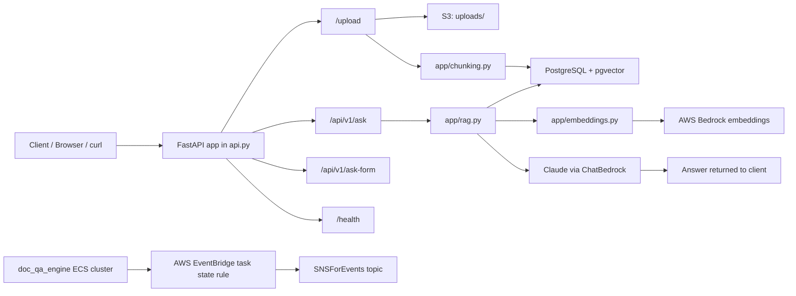
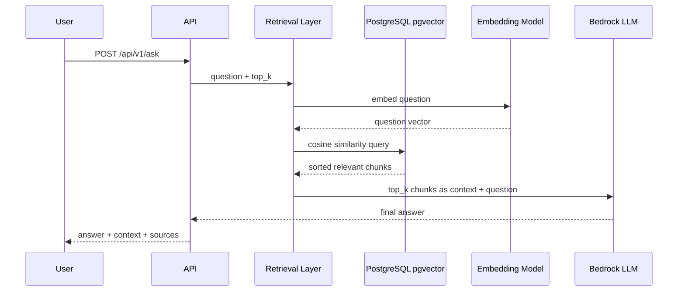
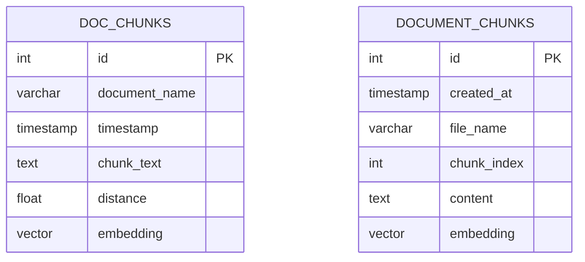
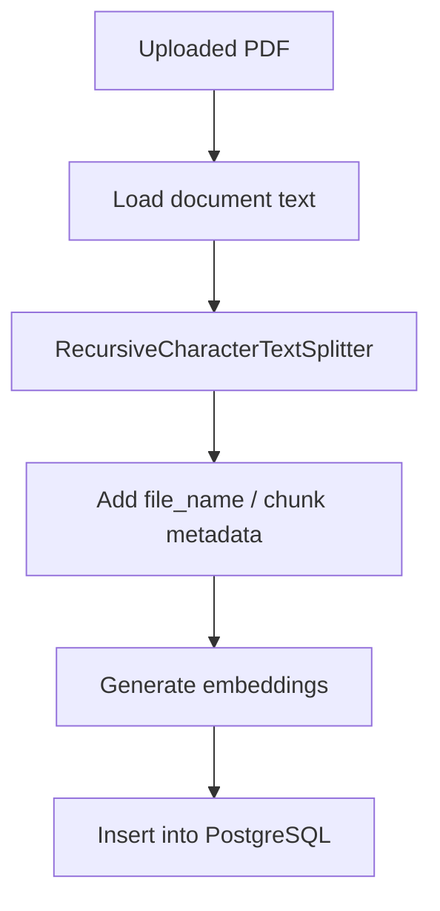

# Document QA + Loader API


This project is a FastAPI-based document ingestion and question
answering system built around pgvector and AWS Bedrock.

The application now uses a single entry point in `api.py`, where the
upload and QA routes are exposed together. Ingestion and retrieval
logic is separated into focused modules under `app/`.

The API is containerized with `docker/Dockerfile.loader` and can be
deployed as an Amazon ECS service using an image stored in Amazon ECR.
The application uses AWS Bedrock for embeddings and answer generation,
S3 for uploaded PDFs, and PostgreSQL with pgvector for chunk storage
and retrieval.

The project also includes an AWS EventBridge integration in
`infrastructure/eventbridge.tf`. It monitors `RUNNING` and `STOPPED`
task state changes for the `doc_qa_engine` ECS cluster and sends a
formatted task ARN and status notification to the existing
`SNSForEvents` SNS topic.

## Overview

The upload and question-answering workflow is:

1. A PDF is sent to `/upload` and saved to the S3 bucket at
   `uploads/<filename>`.
2. The API writes a temporary local copy and sends it through the
   chunking pipeline.
3. Each chunk is embedded with an AWS Bedrock model and stored in
   PostgreSQL with pgvector.
4. A user question is embedded and compared against stored vectors
5. The best matching chunks are gathered and passed as context to
   Claude through Bedrock.
6. The final answer is returned to the client

## System architecture



## Application structure

```text
.
├── api.py                     # single FastAPI entry point
├── app/
│   ├── __init__.py
│   ├── chunking.py            # PDF chunking and ingestion logic
│   ├── db_client.py           # PostgreSQL connection and inserts
│   ├── embeddings.py          # Bedrock embedding helper
│   ├── rag.py                 # retrieval and answer generation
│   └── main.py                # older project utility
├── docker/
│   ├── create_table.sql       # pgvector schema setup
│   ├── docker-compose.db.yml  # Postgres container
│   ├── docker-compose.loader.yml
│   ├── Dockerfile.loader
│   └── ...
├── infrastructure/
├── model_files/
├── src/
├── tests/
├── pyproject.toml
├── README.md
├── notes.txt
└── terraform.tfstate
```

## API endpoints

### GET /health

Returns service health status.

```bash
curl http://localhost:8000/health
```

### POST /upload

Uploads the original PDF to the configured S3 bucket under
`uploads/<filename>`, then processes a temporary local copy with the
chunking pipeline and stores the resulting chunks in PostgreSQL. The
response includes the S3 location.

```bash
curl -X POST "http://localhost:8000/upload" \
  -F "file=@sample.pdf" \
  -F "distance=10"
```

Example response:

```json
{
  "status": "success",
  "filename": "sample.pdf",
  "distance": 10.0,
  "s3_location": "s3://<bucket>/uploads/sample.pdf"
}
```

### POST /api/v1/ask

Queries pgvector for the most relevant chunks and answers the question
using the retrieved context.

```bash
curl -X POST "http://localhost:8000/api/v1/ask" \
  -H "Content-Type: application/json" \
  -d '{
    "question": "What is the key requirement in this document?",
    "top_k": 5
  }'
```

### POST /api/v1/ask-form

Same as the JSON route, but accepts form input.

```bash
curl -X POST "http://localhost:8000/api/v1/ask-form" \
  -F "question=What is the key requirement in this document?" \
  -F "top_k=5"
```

## RAG retrieval flow



## Database schema

The project stores chunk vectors in the `doc_chunks` table and uses
pgvector similarity search.



  ### DynamoDB chat history

  Terraform defines the `doc_qa_chat_history` table in
  `infrastructure/dynamodb.tf` for chat-session messages. The table
  uses `session_id` as its partition key and `message_id` as its sort
  key, allowing multiple messages per session. It uses on-demand
  billing (`PAY_PER_REQUEST`) and enables TTL on the `ttl` attribute.
  Write `ttl` as a Unix timestamp in seconds when a message should
  expire. The Terraform provider uses `eu-central-1`; the table is
  tagged with the `poc` environment and `doc_qa_engine` project.

  To review and apply the Terraform configuration:

  ```bash
  cd infrastructure
  terraform init
  terraform plan
  terraform apply
  ```

  Review the plan before applying: Terraform operates on all resources
  configured in `infrastructure/`, not only the DynamoDB table. This
  table is provisioned independently; document retrieval continues to
  store chunks in PostgreSQL with pgvector.

  Terraform also configures `infrastructure/eventbridge.tf` to send
  `RUNNING` and `STOPPED` ECS task status notifications for the
  `doc_qa_engine` cluster to the existing SNS topic `SNSForEvents`.
  The topic must already exist in the AWS account and Region configured
  by the provider. The EventBridge rule and its IAM role/policy are
  included in the same `terraform plan` and can be deployed using the
  commands above.

## Storage and query behavior

The active retrieval table is `doc_chunks`.

Each row contains:

- `id` — primary key
- `document_name` — source file name
- `timestamp` — ingestion time
- `chunk_text` — chunk content
- `distance` — optional metadata field
- `embedding` — vector representation from Bedrock

The retrieval process does the following:

- embeds the incoming question
- runs a vector similarity search against the stored embeddings
- orders results by distance or cosine similarity
- sends the highest-ranked chunks as contextual input to the LLM
- keeps the relevant context ordered from strongest match to weaker match

## Chunking behavior

The project uses the chunking pipeline in `app/chunking.py` to split
PDFs into semantically manageable blocks.



## Local development

### Requirements

- Python 3.13+
- Docker and Docker Compose
- PostgreSQL with pgvector enabled
- AWS Bedrock access and valid credentials

### Install dependencies

```bash
pip install -e .
```

Or with uv:

```bash
uv sync
```

### Start the database

```bash
cd docker
docker compose -f docker-compose.db.yml up -d
```

### Start the API

From the project root:

```bash
uvicorn api:app --host 0.0.0.0 --port 8000 --reload
```

Then open:

- `http://localhost:8000/docs`
- `http://localhost:8000/health`

## Codacy analysis

The [Codacy Security Scan workflow](./.github/workflows/codacy.yml)
runs on pushes and pull requests targeting `main`, and every Saturday
at 14:18 UTC. It generates a SARIF report and uploads it to GitHub code
scanning. Configure the repository secret `CODACY_PROJECT_TOKEN` for
the scan action to authenticate; review workflow runs in **Actions**
and findings in **Security → Code scanning**.

## Environment variables

### S3 document storage

The upload endpoint currently uses the bucket
`enterprise-document-storage-prod-eu-central-1` in `eu-central-1`.
These values are configured in `api.py`, not read from environment
variables. Provision the bucket with the Terraform configuration in
`infrastructure/s3.tf` before using uploads. The bucket blocks public
access, enables KMS server-side encryption, and has versioning enabled.

The AWS identity used by the API must be allowed to write objects under
the `uploads/` prefix. For example, grant `s3:PutObject` on the bucket's
`uploads/*` path. Configure credentials through the standard AWS SDK
credential chain (environment variables, an AWS profile, or the
workload's IAM role).

### PostgreSQL

```bash
DB_HOST=localhost
DB_PORT=5433
DB_USER=postgres
DB_PASSWORD=postgres
DB_NAME=postgres
```

### AWS / Bedrock

```bash
AWS_REGION=eu-central-1
AWS_DEFAULT_REGION=eu-central-1
AWS_ACCESS_KEY_ID=...
AWS_SECRET_ACCESS_KEY=...
AWS_EMBEDDING_MODEL=amazon.titan-embed-text-v2:0
```

## Docker configuration

The loader container is configured to run the unified app entry point.

```yaml
services:
  loader-api:
    build:
      context: ..
      dockerfile: docker/Dockerfile.loader
    ports:
      - "8000:8000"
    command: uvicorn api:app --host 0.0.0.0 --port 8000
```

From the project root, start the API with Docker Compose:

```powershell
docker compose -f docker/docker-compose.loader.yml up --build
```

Open `http://localhost:8000/docs` for interactive API documentation, or
`http://localhost:8000/health` to check that the API is running. To run
it in the background and follow its logs:

```powershell
docker compose -f docker/docker-compose.loader.yml up --build -d
docker compose -f docker/docker-compose.loader.yml logs -f
```

Stop the container with:

```powershell
docker compose -f docker/docker-compose.loader.yml down
```

The Compose file starts the API only. Endpoints that use AWS or
PostgreSQL also require those services to be reachable and
credentials/configuration to be available inside the container.

## Deploy to AWS ECS with Amazon ECR

The loader image is built from the repository root using
`docker/Dockerfile.loader`. Push it to an ECR repository in the AWS
account and Region used by the ECS service, then update the ECS task
definition to reference the image. The Terraform files configure
selected AWS resources, but do not define the ECR repository, ECS
cluster, task definition, or ECS service. Those resources must already
exist or be provisioned separately.

### Build and push the image

The following PowerShell example uses placeholders. Replace them with
your AWS account ID, Region, and ECR repository name. Create the ECR
repository once before the first push.

```powershell
$AwsAccountId = "<aws-account-id>"
$AwsRegion = "eu-central-1"
$EcrRepository = "<ecr-repository-name>"
$ImageTag = "latest"
$EcrRegistry = "${AwsAccountId}.dkr.ecr.${AwsRegion}.amazonaws.com"
$ImageUri = "${EcrRegistry}/${EcrRepository}:${ImageTag}"

aws ecr create-repository `
    --repository-name $EcrRepository `
    --region $AwsRegion
aws ecr get-login-password --region $AwsRegion |
    docker login --username AWS --password-stdin $EcrRegistry
docker build --platform linux/amd64 `
    -f docker/Dockerfile.loader `
    -t $ImageUri .
docker push $ImageUri
```

If the repository already exists, skip
`aws ecr create-repository`. Build for the CPU architecture configured
for the ECS task definition (for example, use `linux/arm64` for an
ARM64 task).

### Configure and release the ECS service

1. In the ECS task definition, set the application container image to
   the full ECR image URI printed above. Register a new revision.
2. Set the container port to `8000` and make it reachable through the
   service's networking and load-balancer configuration, if applicable.
3. Provide the environment variables listed below. Set `DB_HOST` to a
   PostgreSQL hostname reachable from the task, not `localhost`.
   Configure the database firewall to allow connections from the task.
4. Give the ECS **task role** permission to invoke the required Bedrock
   models and write uploaded objects to the configured S3 bucket. Use
   the **task execution role** to pull the ECR image and send logs.
   Prefer injecting database passwords from AWS Secrets Manager or
   Parameter Store instead of storing them as plain text in the task
   definition.
5. Update the ECS service to use the new task definition revision and
   wait for the deployment to become stable.

The task role's Bedrock permissions must include
`bedrock:InvokeModel` for the embedding and generation models in the
configured Region. S3 permissions must allow uploads to `uploads/*` in
the bucket configured by `api.py`. Confirm model availability and
access in that Region before deployment.

The current code configures the upload bucket and S3 client Region in
`api.py` (`enterprise-document-storage-prod-eu-central-1` and
`eu-central-1`). The Bedrock generation model is configured in
`app/rag.py` (`eu.anthropic.claude-sonnet-4-5-20250929-v1:0`). Update
those settings and rebuild the image if deploying to a different
bucket or changing the generation model.

After deployment, verify the service at
`http://<service-address>/health` and use
`http://<service-address>/docs` to inspect the API. The ECS security
group, load balancer, and network rules should expose only the
endpoints needed by your clients.

### Runtime configuration

Configure these values in the ECS task definition or inject secrets at
runtime. The defaults shown are for the local Compose database only;
use the deployed database's hostname, port, database, user, and secret.

- `DB_HOST`, `DB_PORT`, `DB_NAME`, `DB_USER`, `DB_PASSWORD`: PostgreSQL
  connection settings. ECS tasks need database network access.
- `AWS_REGION` / `AWS_DEFAULT_REGION`: Region for Bedrock clients. Set
  both to the same Region. RAG uses `AWS_REGION`; embeddings prefer
  `AWS_DEFAULT_REGION`. The S3 Region is fixed in `api.py`.
- `AWS_EMBEDDING_MODEL`: Bedrock embedding model ID. Default:
  `amazon.titan-embed-text-v2:0`.

When running on ECS, grant AWS permissions through the task role.
Avoid static `AWS_ACCESS_KEY_ID` and `AWS_SECRET_ACCESS_KEY` task
environment variables. They are optional for local development, but
should not replace an ECS task role.

### Upload and ingestion behavior

The upload endpoint stores the original PDF in S3, then chunks it,
generates embeddings, and writes chunks to PostgreSQL. Embedding
failures are logged and processing continues without attaching vectors.
Ingestion can therefore finish without a vector record for each chunk.
Chunking and database-write failures are logged and propagated, so the
upload request returns an error when those stages fail. If ingestion
fails, check the ECS logs and verify database credentials, network
routing, Bedrock model ID/Region/access, and S3 permissions.

## Notes

- The old split entry-point files were removed in favor of the single
  app module `api.py`.
- Business logic is organized into individual modules for easier reuse
  and maintenance.
- Retrieval is grounded in stored vector data and keeps the most
  relevant context near the start of the prompt.
- For production, use managed PostgreSQL with pgvector or another
  persistent database reachable from ECS. The local Compose database
  is for development and should not be exposed publicly.

## Summary

This repository combines PDF ingestion, chunking, embedding
generation, pgvector storage, and Bedrock-powered RAG to create a
lightweight document QA system with a clean FastAPI interface.
